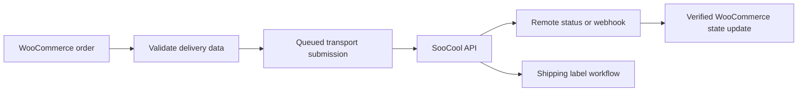

# SooCool for WooCommerce — Transport API Integration

> **Portfolio project · WordPress/PHP · WooCommerce · REST API · webhooks · HPOS · background processing**

SooCool for WooCommerce connects WooCommerce orders to the SooCool transport platform. It handles order submission, delivery scheduling, status updates, retries and shipping labels while keeping API credentials, webhook handling and order state changes behind explicit safety boundaries.

**Developer profile:** [Andrew Baeten](https://github.com/Yolol100) · [GitHub project index](https://github.com/Yolol100?tab=repositories)

## See the integration

| Connection settings | Test order workflow |
| :---: | :---: |
|  |  |

[Read the WooCommerce logistics integration case study](https://andrewbaeten.nl/socool-for-woocommerce/), including the problem, my contribution and interface examples.

**Why a store needs this:** a paid delivery order must reach the transport provider without creating duplicate shipments. Background processing, authenticated webhooks and cautious status handling protect the order workflow when a provider is slow or unavailable.

*The screenshots are from my public portfolio. Automated runtime tests validate specific scenarios; production provider delivery outcomes must be verified separately.*

## What problem it solves

Shipping integrations sit between ecommerce, customer data and an external logistics provider. A failure can create duplicate transport orders, stale statuses or broken fulfilment. This plugin turns that integration into a controlled WooCommerce workflow with asynchronous processing, replay protection and explicit compatibility boundaries.

## Portfolio snapshot

| Area | What it demonstrates |
| --- | --- |
| WooCommerce | HPOS-compatible order access and admin workflows |
| API integration | Test/production environments, authenticated requests and remote status handling |
| Webhooks | Timestamped HMAC verification, replay protection and fail-closed state changes |
| Background work | Queued order submission, retries, label prefetch and maintenance recovery |
| Checkout | Delivery-moment selection with server-side validation |
| Privacy & security | Masked API keys, sanitized logging and scoped personal-data handling |
| Compatibility | Real WordPress/WooCommerce runtime matrices and explicit unsupported-state declarations |

## Workflow at a glance

## Important engineering choices

- Orders are submitted only when WooCommerce considers them paid; pending or failed payments stay outside the transport queue.
- Existing remote orders are linked safely instead of blindly recreated.
- Ambiguous remote task statuses do not overwrite WooCommerce order state.
- Checkout Blocks support stays staging-first until parity is proven.
- HPOS compatibility uses WooCommerce order APIs rather than direct legacy post access.
- Operational logs avoid intentionally storing API keys or complete personal-data payloads.

## Requirements

- WordPress 6.5+
- PHP 8.1+
- WooCommerce
- Current stable version and full compatibility notes: see [`readme.txt`](readme.txt)

## Set up and review on staging

This is an **integration**, not a static demo. A functioning connection requires WooCommerce and authorized SooCool test credentials. Never add API keys, order addresses or customer details to GitHub.

1. Install and activate WooCommerce on a disposable or staging WordPress site.
2. Upload and activate this plugin. Open **WooCommerce → SooCool**.
3. Select the **Test** environment and configure its authorized API key, pickup details, delivery schedule and label preferences.
4. Run the connection test. Create a **test** physical order and move it through the WooCommerce-paid path in a test setup.
5. Inspect transport submission, webhook handling, retry safeguards and label output before considering a production connection.

**Why the safeguards matter:** A delayed webhook or failed network request should not silently turn into a second transport order or an incorrect WooCommerce status. See the [regression suite](tests/) and [real WooCommerce runtime workflow](.github/workflows/woocommerce-runtime.yml) for the specific behaviour that is tested.

**Limits:** Checkout Blocks integration is not claimed as production-ready; runtime tests do not prove any live shipping-provider service level or business improvement. More setup and privacy details are in [WordPress plugin documentation](readme.txt).

## Installation (staging first)

1. Install and activate WooCommerce, then upload and activate this plugin.
2. Open **WooCommerce → SooCool** and select the **Test** environment.
3. Enter the test API key in the settings, or use the server-side `SOOCOOL_API_KEY` constant.
4. Configure the pickup/contact details and delivery schedule, then run the connection test.
5. Place a test order and verify submission, webhook handling and label flow before enabling production credentials.

The integration communicates with SooCool and transfers the shipment information required for fulfilment. Review [installation, privacy and API details](readme.txt) before deployment; never commit API keys or customer data.

## Technical review

Useful places to inspect:

- `src/` — application logic and integration boundaries.
- `tests/` — regression and runtime-oriented coverage.
- [`.github/workflows/plugin-quality.yml`](.github/workflows/plugin-quality.yml) — coding standards and regression checks.
- [`.github/workflows/woocommerce-runtime.yml`](.github/workflows/woocommerce-runtime.yml) — clean WordPress/WooCommerce runtime validation.
- `phpcs.xml.dist` — PHP coding-standard configuration.
- [`readme.txt`](readme.txt) — full installation, privacy, compatibility and changelog documentation.

## About the developer

I am **Andrew Baeten**, a WordPress Developer with **10 years of experience**, **90 delivered projects** and responsibility for **120 websites and webshops**. My work combines WordPress, WooCommerce, Elementor, UX, performance, technical SEO and quality-focused delivery.

[GitHub project index](https://github.com/Yolol100?tab=repositories) · [LinkedIn](https://www.linkedin.com/in/andrew-baeten-305a1478/) · [Email](mailto:info@andrewbaeten.nl)

## License

See [`LICENSE`](LICENSE).
